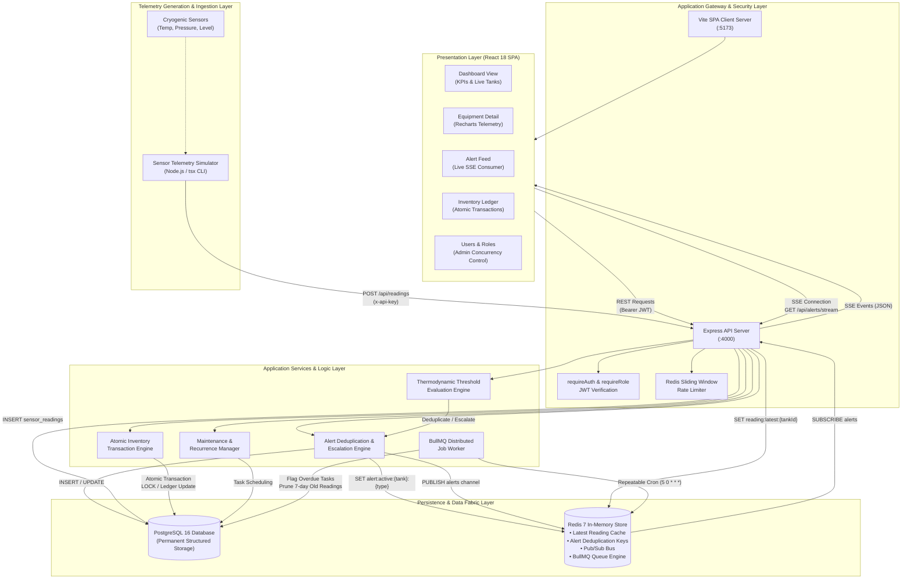
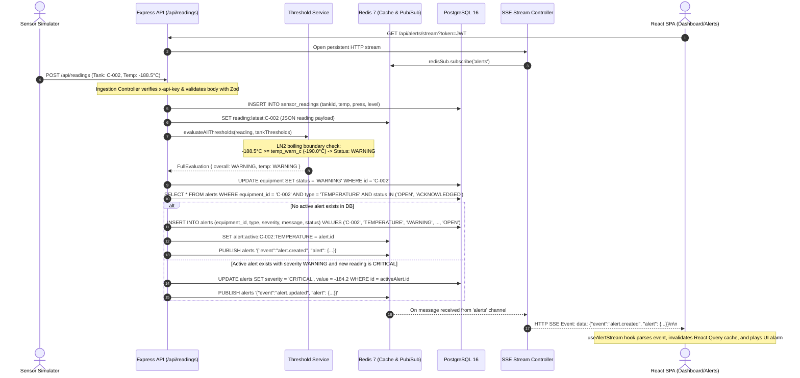

# Comprehensive Technical Investigation & System Audit: CryoGuard

**Project Name:** CryoGuard — Cryogenic Facility Control & Safety System  
**Repository Location:** `c:\My Projects\CryoGuard`  
**System Architecture:** Multi-tier Distributed Architecture (React + Vite SPA, Node.js + Express API, PostgreSQL, Redis, BullMQ, Telemetry Simulator)  
**Investigation Date:** October 20, 2026  
**Auditor Roles:** Senior Software Architect, AI/ML Engineer, Systems Analyst, and Technical Documentation Specialist  

---

## A. EXECUTIVE SUMMARY

### 1. What CryoGuard Actually Is
**CryoGuard** is an industrial-grade, full-stack Supervisory Control, Facility Monitoring, and Safety Management System engineered specifically for bulk cryogenic storage facilities. In cryogenic industrial contexts, facilities store liquefied gases—primarily **Liquid Nitrogen ($\text{LN}_2$)**, **Liquid Oxygen ($\text{LOX}$)**, and **Liquid Argon ($\text{Ar}$)**—under extreme sub-zero temperatures (ranging from $-196^\circ\text{C}$ to $-180^\circ\text{C}$) and pressurized containment (typically 1.0 to 2.5 bar). 

CryoGuard provides continuous telemetry ingestion, automated thermodynamic threshold checking, real-time alert dispatching via Server-Sent Events (SSE), checklist-driven statutory safety inspections, preventive and recurring maintenance scheduling, and an atomic, transaction-based bulk material inventory ledger.

### 2. What CryoGuard Does
* **Real-Time Telemetry Supervision:** Ingests high-frequency sensor readings (temperature in $^\circ\text{C}$, vessel head pressure in $\text{bar}$, and volumetric liquid level percentage) from cryogenic storage vessels via an authenticated REST ingestion gateway.
* **Thermodynamic Anomaly Detection:** Compares incoming physical parameters against per-vessel, material-specific thermodynamic thresholds (reflecting differing boiling points: $\text{LN}_2$ at $-195.8^\circ\text{C}$, $\text{LOX}$ at $-182.96^\circ\text{C}$, Argon at $-185.8^\circ\text{C}$), dynamically categorizing vessel status as `NORMAL`, `WARNING`, `CRITICAL`, or `OFFLINE`.
* **Stateful Alert Lifecycle & Deduplication:** Generates warning and critical alerts when physical parameters, maintenance dates, inspection failures, or inventory thresholds are breached. Prevents notification storms via Redis-based deduplication keys and in-place alert escalation.
* **Reactive Telemetry Streaming:** Pushes live alerts and telemetry invalidation signals instantly to connected operators via HTTP Server-Sent Events (`GET /api/alerts/stream`).
* **Preventive & Recurring Maintenance Management:** Tracks maintenance work orders with an automated BullMQ daily background cron job that flags overdue tasks, escalates aging tasks, and automatically calculates and schedules the next recurring task interval.
* **Statutory Checklist Inspections:** Digitizes safety inspections against versioned checklist templates with automated evaluation logic: any single checklist item failure automatically marks the inspection as `NEEDS_ATTENTION` or `FAIL` and raises an audit-tracked `INSPECTION` alert.
* **Atomic Material Inventory Ledger:** Tracks cryogenic gas supplies and consumable safety gear using double-entry style ledger transactions (`IN`, `OUT`, `ADJUST`). It enforces atomic database updates, prevents negative inventory balances, automatically computes stock health (`GOOD`, `LOW`, `CRITICAL`), and manages procurement restock lifecycles (`PENDING` $\rightarrow$ `APPROVED` $\rightarrow$ `ORDERED` $\rightarrow$ `RECEIVED`).
* **Role-Based Access Control & Concurrency Defense:** Implements role differentiation (`ADMIN` vs. `STAFF`) with server-enforced JWT route guards, session revocation on account deactivation, and table-level PostgreSQL locking (`LOCK TABLE users IN SHARE ROW EXCLUSIVE MODE`) to prevent race conditions during administrator demotion and deactivation.

### 3. Target Audience & Operational Stakeholders
1. **Cryogenic Facility Operations Staff / Field Technicians:** Perform daily walk-through inspections, log material withdrawals, acknowledge threshold alarms, and execute scheduled preventive maintenance.
2. **Facility Managers / Safety Compliance Officers:** Supervise plant-wide safety margins, review incident audit logs, analyze multi-month thermodynamic trends, approve procurement restock requests, and manage staff credentials.

### 4. Key Value Proposition & Academic Significance
Unlike generic IoT dashboards that assume homogeneous sensor ranges and treat all metrics identically, CryoGuard solves the physical domain challenges of cryogenic thermodynamics. It eliminates dangerous operational blind spots by maintaining distinct, per-vessel threshold baselines tied to the specific physical boiling points of cryogens. 

Architecturally, the project balances high-throughput write ingestion with fast UI rendering by pairing PostgreSQL (durable, ACID-compliant historical storage) with Redis (sub-millisecond latest-reading cache, deduplication locks, pub/sub, and distributed job queues).

---

## B. PROJECT STRUCTURE

The CryoGuard repository is organized as a clean, decoupled TypeScript monorepo with dedicated root-level orchestration:

```
c:\My Projects\CryoGuard\
├── .env                       # Live environment configuration (ports, database URLs, JWT keys)
├── .env.example               # Template environment configuration
├── .gitignore                 # Git ignore rules for node_modules, build artifacts, dist, etc.
├── docker-compose.yml         # Multi-container orchestration (Postgres, Redis, Server, Client)
├── PLAN.md                    # Master Architecture Specification & Implementation Plan
├── README.md                  # System overview, credentials, quick start, API guide
├── docs/                      # Technical documentation and UI capture artifacts
│   └── screenshots/           # Application screenshots for technical reporting
├── client/                    # Frontend Single Page Application (React 18, Vite 5, Tailwind CSS)
│   ├── index.html             # Entry HTML with Plus Jakarta Sans typography
│   ├── package.json           # Client dependencies and build scripts
│   ├── tsconfig.json          # TypeScript project configuration
│   ├── vite.config.ts         # Vite bundler configuration (dev server on 0.0.0.0:5173)
│   ├── tailwind.config.js     # Enterprise design system tokens (Ciklum-inspired palette)
│   └── src/
│       ├── main.tsx           # React DOM root initialization with React Query provider
│       ├── App.tsx            # React Router v6 route configuration and auth guard hierarchy
│       ├── api/               # Typed Axios client modules for all REST endpoints
│       ├── components/        # Reusable UI component library (layout, auth, navigation)
│       ├── context/           # React Context (AuthContext for JWT and user session state)
│       ├── hooks/             # Custom React hooks (useAlertStream for SSE and cache sync)
│       ├── pages/             # 10 fully realized operational pages and views
│       └── types/             # Domain TypeScript interfaces and enumerations
├── server/                    # Backend API Server (Node.js, Express, TypeScript, Prisma ORM)
│   ├── Dockerfile             # Multi-stage containerization build for server
│   ├── entrypoint.sh          # Container startup script (migrations, seeding, app launch)
│   ├── package.json           # Backend dependencies, BullMQ, Prisma, Vitest runner
│   ├── tsconfig.json          # Backend TypeScript configuration
│   ├── vitest.config.ts       # Test runner configuration for unit and integration suites
│   ├── prisma/
│   │   ├── schema.prisma      # PostgreSQL data models, relations, indices, and enums
│   │   ├── migrations/        # Version-controlled SQL migration history
│   │   └── seed.ts            # Baseline database seeder (users, tanks, templates, inventory)
│   ├── scripts/               # Test harness and race-condition verification scripts
│   └── src/
│       ├── index.ts           # Express server entry point, middleware pipeline, graceful shutdown
│       ├── config/            # Security and auth configuration validators
│       ├── controllers/       # HTTP request handlers and business logic dispatchers
│       ├── db/                # Database clients (Prisma PostgreSQL singleton, Redis IORedis instances)
│       ├── jobs/              # BullMQ queue definition, worker logic, repeatable cron jobs
│       ├── middleware/        # JWT auth, role authorization, and Redis sliding-window rate limiters
│       ├── routes/            # Express modular route definitions mounted under /api
│       ├── services/          # Pure thermodynamic threshold evaluation algorithms
│       ├── types/             # Express augmentations and backend internal interfaces
│       └── utils/             # Audit logging utility and CSV stream formatters
└── simulator/                 # Standalone Cryogenic Telemetry Simulation Engine
    ├── package.json           # Simulation engine dependencies (axios, tsx)
    └── src/
        └── index.ts           # Scenario runner (normal, temp-spike, low-level drain)
```

### Purpose of Key Files
* `docker-compose.yml`: Orchestrates four networked services: PostgreSQL 16 on `5433:5432`, Redis 7 on `6379:6379`, the Express backend on `4000:4000`, and Vite client on `5173:5173`.
* `PLAN.md`: The master source of truth documenting architecture, database schema, role definitions, and Phase 0 through Phase 9 milestones.
* `server/src/index.ts`: Configures Helmet, CORS origin allowlists, Pino logging with token sanitization, mounts routes under `/api`, connects Redis, starts BullMQ workers, and coordinates graceful teardown.
* `server/prisma/schema.prisma`: Declares 10 relational entities, 8 enumerations, composite indexes, foreign keys with cascading actions, and JSONB structures.
* `server/src/services/threshold.service.ts`: Pure, framework-agnostic mathematical functions evaluating thermodynamic boundaries.
* `server/src/jobs/index.ts`: Implements BullMQ background queue workers for midnight maintenance evaluations and automated 7-day telemetry data retention cleanup.
* `client/src/hooks/useAlertStream.ts`: Connects to the SSE stream (`/api/alerts/stream`), auto-reconnects on disconnection, and selectively invalidates React Query caches upon receiving alert events.

---

## C. PROBLEM STATEMENT AND PROJECT OBJECTIVES

### 1. Problem Statement
Bulk cryogenic liquids are essential in modern industry, including semiconductor manufacturing, metallurgy, biological specimen cryopreservation, and medical life-support systems. Maintaining these materials in a liquid state presents significant operational challenges:
* **Severe Thermodynamic Volatility:** Cryogens boil at temperatures far below ambient. A failure in insulation, a loss of the vacuum jacket, or thermal stratification can trigger rapid boil-off, leading to extreme pressure escalation (1 volume of liquid nitrogen expands to ~694 volumes of gas at standard temperature and pressure). This introduces severe risks of catastrophic vessel over-pressurization, structural rupture, asphyxiation due to oxygen displacement ($\text{LN}_2$/$\text{Ar}$), or enhanced combustion hazards ($\text{LOX}$).
* **Limitations of Existing Systems:** In small-to-midscale facilities, cryogenic monitoring is frequently fragmented. Operators rely on manual dial gauge logging, sporadic physical inspection clipboards, and disconnected spreadsheets for tracking gas refills. Physical alarm horns are loud locally but fail to provide centralized historical visibility, preventing operators from detecting slow insulation degradation before safety margins are breached.
* **Risk of Supply Depletion:** Unmonitored boil-off or undetected valve leaks result in unexpected depletion of critical cryogens, disrupting hospital oxygen supply lines or halting manufacturing lines.

### 2. Proposed Solution
CryoGuard introduces an integrated, centralized web-based control and monitoring platform designed to eliminate reliance on disconnected paper workflows and fragmented monitoring tools. 

CryoGuard automates the entire facility safety lifecycle by:
1. Ingesting continuous multi-sensor telemetry into an in-memory cache and a historical time-series database.
2. Dynamically evaluating physical parameters against per-vessel thermodynamic thresholds calibrated to each cryogen's boiling point.
3. Automatically raising, de-duplicating, and escalating alarms with instant operator notification via Server-Sent Events.
4. Enforcing preventative maintenance cadences through automated overdue detection and recurring task generation.
5. Standardizing daily, weekly, and monthly regulatory walk-through inspections via structured digital checklists with automatic alarm generation upon finding defects.
6. Maintaining an immutable, double-entry inventory ledger for all cryogen stocks and safety consumables.

### 3. Measurable Objectives
* **Sub-Second Alert Latency:** Alert generation and client push notification must complete in $< 500\text{ ms}$ from the moment telemetry crosses a critical safety boundary.
* **Zero Alert Duplication Storms:** Redis deduplication keys must prevent multiple distinct alert records from being generated for the same persistent out-of-bounds condition.
* **100% Invariant Inventory Accounting:** Enforce non-negative inventory balances through database-level transactional locks and double-entry transaction histories.
* **Zero Downtime Fault Tolerance:** Decouple sensor telemetry ingestion from the UI rendering layer using Redis caching so that dashboard queries never block on continuous database write traffic.

---

## D. COMPLETE FEATURE INVENTORY MATRIX

| # | Feature Name | Classification | Primary Modules / Files | Description & Implementation Evidence |
|---|---|---|---|---|
| 1 | **JWT Authentication & Session Management** | **A. Fully Implemented** | `auth.routes.ts`, `auth.controller.ts`, `auth.ts` | Issues signed JWTs (8h expiry). Validates DB user existence and `is_active` state on *every* request. Supports explicit client logout. |
| 2 | **Sliding-Window Login Rate Limiter** | **A. Fully Implemented** | `rateLimiter.ts` | Protects `/api/auth/login` by capping attempts to 10 per 60-second window using Redis `INCR` and `EXPIRE`, with an automatic in-memory fallback map if Redis is unavailable. |
| 3 | **Role-Based Authorization (RBAC)** | **A. Fully Implemented** | `auth.ts`, `RoleProtectedRoute.tsx` | Enforces dual roles: `ADMIN` and `STAFF`. Server returns `403 Forbidden` on admin routes; client router redirects staff away from `/users`. |
| 4 | **User Administration & Demote Protection** | **A. Fully Implemented** | `user.controller.ts`, `UsersPage.tsx` | Allows admins to create, edit, deactivate, and reactivate accounts. Enforces `LOCK TABLE users IN SHARE ROW EXCLUSIVE MODE` to prevent race conditions during self-demotion or demoting the last active admin. |
| 5 | **System Audit Trail** | **A. Fully Implemented** | `audit.ts`, `audit.routes.ts`, `UsersPage.tsx` | Logs user mutations, status adjustments, and inventory activities to the `audit_log` table with metadata JSON diffs. Searchable by admins. |
| 6 | **Telemetry Ingestion Gateway** | **A. Fully Implemented** | `readings.routes.ts`, `readings.controller.ts` | Ingests sensor data via `POST /api/readings` authenticated by `x-api-key`. Validates payloads with Zod and records readings to `sensor_readings`. |
| 7 | **Thermodynamic Threshold Evaluation** | **A. Fully Implemented** | `threshold.service.ts`, `thresholds.test.ts` | Pure deterministic algorithms checking temperature, pressure, and volume against stored per-vessel thresholds. Tested with 33 unit tests. |
| 8 | **Sub-Millisecond Telemetry Caching** | **A. Fully Implemented** | `readings.controller.ts`, `equipment.controller.ts` | Stores latest readings in Redis under `reading:latest:{equipmentId}`. Dashboard and equipment list read directly from cache to prevent slow database queries. |
| 9 | **Alert Deduplication & Escalation Engine** | **A. Fully Implemented** | `readings.controller.ts`, `alert.controller.ts` | Uses Redis dedupe keys `alert:active:{equipmentId}:{type}`. Escalates in-place from `WARNING` to `CRITICAL` without duplicate rows. |
| 10 | **Real-Time Alert Push via SSE** | **A. Fully Implemented** | `alert.controller.ts`, `useAlertStream.ts` | Streams alerts to clients over HTTP SSE (`GET /api/alerts/stream`). Handles Redis Pub/Sub events and sends 15-second heartbeat pings. |
| 11 | **Alert Management (Acknowledge & Resolve)** | **A. Fully Implemented** | `alert.controller.ts`, `AlertsPage.tsx` | Enables staff and admins to review, acknowledge, and resolve alerts, updating the database and releasing the active dedupe locks in Redis. |
| 12 | **Equipment Registry & Lifecycle CRUD** | **A. Fully Implemented** | `equipment.controller.ts`, `EquipmentListPage.tsx` | Manages vessel metadata (code, material, capacity, thresholds). Decommissioning checks for dependent records and returns `409 Conflict` if dependencies exist. |
| 13 | **Vessel Detailed Telemetry Visualizer** | **A. Fully Implemented** | `EquipmentDetailPage.tsx` | Renders three Recharts graphs (temperature, pressure, liquid level depletion) with interactive threshold lines and adjustable limits. |
| 14 | **Executive Operations Dashboard** | **A. Fully Implemented** | `dashboard.controller.ts`, `DashboardPage.tsx` | Displays plant-wide KPIs, active alert feeds, interactive tank summary cards, and quick navigation to operational workflows. |
| 15 | **Preventive Maintenance Management** | **A. Fully Implemented** | `maintenance.controller.ts`, `MaintenancePage.tsx` | Manages maintenance work orders. Completing a recurring task automatically schedules the next task based on its `recurrence_days` offset. |
| 16 | **Automated BullMQ Maintenance & Overdue Evaluator** | **A. Fully Implemented** | `jobs/index.ts` | Repeatable cron job (`5 0 * * *`) that identifies overdue tasks, flags tasks due within 48 hours, and generates corresponding warning or critical alerts. |
| 17 | **Automated 7-Day Readings Pruning** | **A. Fully Implemented** | `jobs/index.ts` | Repeatable cron job (`0 1 * * *`) that prunes sensor readings older than 7 days, maintaining a manageable database footprint. |
| 18 | **Checklist Safety Inspections** | **A. Fully Implemented** | `inspection.controller.ts`, `InspectionsPage.tsx` | Allows staff to complete inspections based on JSONB checklist templates. Evaluates results and raises an `INSPECTION` alert if any item fails. |
| 19 | **Inventory Ledger & Stock Level Tracking** | **A. Fully Implemented** | `inventory.controller.ts`, `InventoryPage.tsx` | Manages inventory using an immutable transaction ledger (`IN`, `OUT`, `ADJUST`). Direct quantity editing is blocked to maintain an accurate audit trail. |
| 20 | **Automated Inventory Threshold Alarms** | **A. Fully Implemented** | `inventory.controller.ts`, `inventory-invariant.test.ts` | Categorizes stock as `GOOD`, `LOW`, or `CRITICAL`. Automatically generates or escalates inventory alerts, resolving them once adequate stock is restored. |
| 21 | **Procurement Restock Workflow** | **A. Fully Implemented** | `inventory.controller.ts`, `InventoryPage.tsx` | Manages restock requests (`PENDING` $\rightarrow$ `APPROVED`/`REJECTED` $\rightarrow$ `ORDERED` $\rightarrow$ `RECEIVED`). Receiving an order automatically records an `IN` ledger transaction. |
| 22 | **Analytics & Aggregated Reports Engine** | **A. Fully Implemented** | `report.controller.ts`, `ReportsPage.tsx` | Generates four multi-series reports with time bucketing (`24h`, `7d`, `30d`, `6m`) and direct CSV file export streams. |
| 23 | **Multi-Scenario Sensor Simulator** | **A. Fully Implemented** | `simulator/src/index.ts` | Simulates continuous sensor telemetry across 6 vessels with options for `normal`, `temp-spike` (thermal breach), and `low-level` (drainage breach) scenarios. |
| 24 | **Automated Database Seeder & Demo History** | **A. Fully Implemented** | `seed.ts`, `seedDemoHistory.ts` | Seeds baseline demo users, vessels, checklist templates, inventory items, and generates 6 months of historical transactions and maintenance tasks. |
| 25 | **Dynamic Machine Learning Depletion Forecasting** | **E. Proposed Future Enhancement** | `PLAN.md#L17` | Planned stretch feature to train regression models on historical boil-off rates to predict depletion dates. **Not implemented in current codebase.** |
| 26 | **External Email / SMS Notification Dispatcher** | **E. Proposed Future Enhancement** | `PLAN.md#L17` | Planned integration for external SMTP or Twilio SMS notifications. **Not implemented in current codebase.** |

---

## E. TECHNOLOGY STACK AND DEPENDENCY ANALYSIS

### 1. Technology Roles & Version Analysis

```
Frontend:   React 18.3.1 | Vite 5.4.6 | TypeScript 5.6.2 | Tailwind CSS 3.4.11 | Recharts 2.12.7 | TanStack Query 5.56.2
Backend:    Node.js v20 LTS | Express 4.21.0 | Prisma ORM 5.20.0 | BullMQ 5.14.0 | IORedis 5.4.1 | Pino 9.4.0 | Zod 3.23.8
Database:   PostgreSQL 16 Alpine | Redis 7 Alpine
DevOps:     Docker Compose v2 | Vitest 2.1.8 | ESLint 8.57.0 | Prettier 3.3.3
```

| Layer | Technology | Version | Actual Role in Implementation |
|---|---|---|---|
| **Runtime Environment** | **Node.js** | `v20.x LTS` | Powers both the backend API server and the standalone telemetry simulator. |
| **Backend Framework** | **Express** | `4.21.0` | Provides the REST routing pipeline, JSON body parsing, error middleware, and SSE stream endpoints. |
| **Language** | **TypeScript** | `5.6.2` | Provides static typing across client, server, and simulator, ensuring consistent interfaces throughout the project. |
| **Object-Relational Mapping** | **Prisma ORM** | `5.20.0` | Manages relational schema definition, automated migrations, type-safe query generation, and raw SQL connection locking. |
| **Primary Relational Store** | **PostgreSQL** | `16-alpine` | Stores permanent, ACID-compliant relational records across 10 tables, with foreign keys and composite indexes. |
| **In-Memory Cache & Pub/Sub** | **Redis** | `7-alpine` | Provides sub-millisecond caching of latest telemetry, atomic deduplication keys, SSE pub/sub messaging, and BullMQ backing. |
| **Background Task Processing** | **BullMQ** | `5.14.0` | Manages persistent, repeatable background cron jobs for midnight maintenance checks and 7-day telemetry pruning. |
| **Input Validation** | **Zod** | `3.23.8` | Validates all incoming REST payloads, ensuring schema compliance and preventing injection of invalid values. |
| **Security & Cryptography** | **bcryptjs & jsonwebtoken** | `^2.4.3` / `^9.0.2` | Manages salted password hashing (work factor 10) and signed JWT session generation and validation. |
| **HTTP Security & CORS** | **Helmet** | `7.1.0` | Sets protective HTTP headers (X-Frame-Options, HSTS, noSniff) and enforces strict cross-origin allowlisting. |
| **Structured Logging** | **Pino & Pino-HTTP** | `9.4.0` / `10.3.0` | Outputs structured JSON logs with custom serializers that redact sensitive auth tokens from logged URLs. |
| **Frontend UI Library** | **React** | `18.3.1` | Renders the single-page application component hierarchy using functional components and hooks. |
| **Build & Bundling Engine** | **Vite** | `5.4.6` | Provides fast development bundling with Hot Module Replacement and generates optimized production builds. |
| **Client Routing** | **React Router DOM** | `6.26.2` | Manages browser navigation, route transitions, and handles role-based route protection (`RoleProtectedRoute`). |
| **Server State Synchronization** | **TanStack Query** | `5.56.2` | Coordinates client-side caching, background refetching, and selective cache invalidation triggered by incoming SSE events. |
| **CSS & Design System** | **Tailwind CSS** | `3.4.11` | Provides a structured utility-class design system implementing the Ciklum-inspired corporate palette. |
| **Telemetry Charting** | **Recharts** | `2.12.7` | Renders SVG-based data visualizations, including real-time telemetry line charts and historical bar charts. |
| **Form Management** | **React Hook Form** | `7.53.0` | Manages form state, validation, and error presentation for inspections, user creation, and inventory forms. |
| **Iconography** | **Lucide React** | `0.441.0` | Provides consistent SVG interface icons throughout the application. |
| **Testing Harness** | **Vitest** | `2.1.8` | Executes unit and integration test suites, verifying thresholds, CSV generation, auth guards, and inventory logic. |

---

## F. SOFTWARE ARCHITECTURE AND DATA FLOW

### 1. System Architecture Diagram



---

### 2. End-to-End Execution Sequence: Anomaly Ingestion, Alert Escalation, and SSE Broadcast



---

## G. MODULE-BY-MODULE TECHNICAL ANALYSIS

### 1. Authentication & Session Module
* **Backend Source:** `auth.routes.ts`, `auth.controller.ts`, `auth.ts`
* **Frontend Source:** `AuthContext.tsx`, `LoginPage.tsx`
* **Mechanisms:** Issues a signed JWT upon successful validation of user credentials against bcrypt hashes (cost factor 10). The JWT payload carries `userId`, `role`, `email`, and `name`. 
* **Live State Verification:** Unlike simple stateless JWT patterns, CryoGuard's `requireAuth` middleware queries the database on every authenticated request:
  ```typescript
  const user = await prisma.user.findUnique({
    where: { id: decoded.userId },
    select: { id: true, name: true, email: true, role: true, is_active: true },
  });
  if (!user || !user.is_active) {
    return res.status(401).json({ error: 'Unauthorized', message: 'Account deactivated.' });
  }
  ```
  This guarantees that deactivated accounts have their access revoked immediately without waiting for token expiration.

### 2. User Administration & Concurrency Protection Module
* **Backend Source:** `user.routes.ts`, `user.controller.ts`
* **Frontend Source:** `UsersPage.tsx`
* **Concurrency Protection (Last-Admin Guard):** When an administrator demotes or deactivates another admin, the system must ensure the facility is never left without an active admin. Simple application-level checks are susceptible to race conditions (e.g., if two admins simultaneously demote each other). CryoGuard prevents this by using PostgreSQL table-level locking:
  ```typescript
  await tx.$executeRaw`LOCK TABLE users IN SHARE ROW EXCLUSIVE MODE`;
  const activeAdminsCount = await tx.user.count({
    where: { role: Role.ADMIN, is_active: true },
  });
  if (activeAdminsCount <= 1) {
    throw new Error('LAST_ACTIVE_ADMIN');
  }
  ```
  This ensures sequential evaluation of concurrent demotion requests, rejecting whichever request would reduce the active admin count below one. Verified via automated concurrency tests in `verify-phase8.ts`.

### 3. Equipment Registry & Telemetry Caching Module
* **Backend Source:** `equipment.routes.ts`, `equipment.controller.ts`
* **Frontend Source:** `EquipmentListPage.tsx`, `EquipmentDetailPage.tsx`
* **Responsibilities:** Manages storage vessels, specifications, locations, and threshold boundaries. 
* **Caching Integration:** When listing storage vessels (`GET /api/equipment`), the system fetches the baseline records from PostgreSQL, queries Redis in parallel using `MGET` across `reading:latest:{equipmentId}` keys, and merges the latest cached sensor readings into the response. This delivers real-time telemetry metrics without running expensive aggregation queries on historical tables.

### 4. Alert Engine & SSE Streaming Module
* **Backend Source:** `alert.routes.ts`, `alert.controller.ts`
* **Frontend Source:** `useAlertStream.ts`, `AlertsPage.tsx`
* **Deduplication Engine:** When a tank reports an out-of-bounds reading every 5 seconds, generating an alert for each tick would flood the database and overwhelm operators. CryoGuard enforces single-active-alert semantics using a composite Redis key (`alert:active:{equipmentId}:{type}`) alongside database-backed validation.
* **In-Place Escalation:** If an active alert is currently at `WARNING` severity and a subsequent reading breaches the `CRITICAL` threshold, the system updates the existing alert record to `CRITICAL` in place and broadcasts an `alert.updated` event over SSE rather than creating a duplicate alert row.

### 5. Preventive Maintenance & BullMQ Worker Module
* **Backend Source:** `maintenance.routes.ts`, `maintenance.controller.ts`, `jobs/index.ts`
* **Frontend Source:** `MaintenancePage.tsx`
* **Automated Recurrence:** When an operator completes a recurring maintenance task (`PATCH /api/maintenance/:id/complete`), the system records `completed_at` and automatically calculates the next due date based on `recurrence_days`:
  ```typescript
  if (task.recurrence_days && task.recurrence_days > 0) {
    const nextDueDate = new Date(task.due_date.getTime() + task.recurrence_days * 86400000);
    await prisma.maintenanceTask.create({
      data: {
        equipment_id: task.equipment_id,
        title: task.title,
        description: task.description,
        due_date: nextDueDate,
        recurrence_days: task.recurrence_days,
        status: MaintenanceStatus.SCHEDULED,
      },
    });
  }
  ```
* **Repeatable Cron Jobs:** A BullMQ background worker runs every midnight (`5 0 * * *`) to scan active tasks. It flags overdue tasks as `OVERDUE`, identifies tasks due within 48 hours, and generates corresponding warning or critical maintenance alerts.

### 6. Safety Inspections & Regulatory Checklists Module
* **Backend Source:** `inspection.routes.ts`, `inspection.controller.ts`
* **Frontend Source:** `InspectionsPage.tsx`, `InspectionDetailPage.tsx`
* **Checklist Evaluation Logic:** Digital inspections are based on templates stored in the `inspection_templates` table. When an inspection is submitted, the controller validates each checklist item. If any item is marked as failed, the overall status is automatically set to `FAIL` or `NEEDS_ATTENTION`, and an `INSPECTION` alert is created with an audit log entry.

### 7. Atomic Inventory Ledger & Restock Lifecycle Module
* **Backend Source:** `inventory.routes.ts`, `inventory.controller.ts`
* **Frontend Source:** `InventoryPage.tsx`
* **Double-Entry Style Ledger:** Items cannot have their stock quantities updated arbitrarily. All quantity changes must occur through explicit ledger transactions (`IN`, `OUT`, `ADJUST`). The transaction controller uses database transactions to update the stock balance and create the audit record simultaneously:
  ```typescript
  const updatedItem = await tx.inventoryItem.update({
    where: { id: itemId },
    data: { quantity: { increment: delta } },
  });
  if (updatedItem.quantity < 0) {
    throw new Error('NEGATIVE_STOCK_DISALLOWED');
  }
  ```
* **Procurement Lifecycle:** Manages restock requests through an approval workflow: `PENDING` $\rightarrow$ `APPROVED` $\rightarrow$ `ORDERED` $\rightarrow$ `RECEIVED`. Transitioning a request to `RECEIVED` automatically triggers an `IN` inventory ledger transaction that updates stock levels.

---

## H. ALGORITHMIC ANALYSIS & ARTIFICIAL INTELLIGENCE AUDIT

### 1. Evaluation of AI / Machine Learning Presence
**Finding:** CryoGuard currently contains **NO** machine learning models, neural networks, deep learning architectures, or statistical regression pipelines. 

While the master plan (`PLAN.md#L17`) lists "depletion forecast" as an optional future enhancement, the current implementation relies entirely on **deterministic rule-based systems and physical thermodynamic calculations**. In an academic or viva context, CryoGuard should be presented as an industrial control, monitoring, and safety system rather than an AI/ML project.

### 2. Implemented Deterministic Algorithms

#### A. Thermodynamic Multi-Boundary Evaluation Algorithm
* **File:** `threshold.service.ts`
* **Domain Context:** Liquid nitrogen boils at $-195.8^\circ\text{C}$, liquid argon at $-185.8^\circ\text{C}$, and liquid oxygen at $-182.96^\circ\text{C}$. A universal threshold across all tanks would result in widespread false alarms or dangerous undetected boil-off conditions.
* **Mathematical Logic:**
  $$\text{Status}_{\text{temp}}(T, \tau_w, \tau_c) = \begin{cases} \text{CRITICAL}, & \text{if } T \ge \tau_c \\ \text{WARNING}, & \text{if } T \ge \tau_w \\ \text{NORMAL}, & \text{otherwise} \end{cases}$$
  $$\text{Status}_{\text{press}}(P, \pi_w, \pi_c) = \begin{cases} \text{CRITICAL}, & \text{if } P \ge \pi_c \\ \text{WARNING}, & \text{if } P \ge \pi_w \\ \text{NORMAL}, & \text{otherwise} \end{cases}$$
  $$\text{Status}_{\text{level}}(L, \lambda_w, \lambda_c) = \begin{cases} \text{CRITICAL}, & \text{if } L \le \lambda_c \\ \text{WARNING}, & \text{if } L \le \lambda_w \\ \text{NORMAL}, & \text{otherwise} \end{cases}$$
  $$\text{Overall Status} = \max(\text{Status}_{\text{temp}}, \text{Status}_{\text{press}}, \text{Status}_{\text{level}})$$
  Where the status ordering is defined as: $\text{NORMAL} < \text{WARNING} < \text{CRITICAL}$.

#### B. Inventory Stock Classification Algorithm
* **File:** `inventory.controller.ts`
* **Mathematical Logic:**
  $$\text{StockStatus}(Q, Q_{\min}) = \begin{cases} \text{CRITICAL}, & \text{if } Q < 0.5 \times Q_{\min} \\ \text{LOW}, & \text{if } Q < Q_{\min} \\ \text{GOOD}, & \text{if } Q \ge Q_{\min} \end{cases}$$

#### C. Redis Sliding-Window Rate Limiting Algorithm
* **File:** `rateLimiter.ts`
* **Logic:** Employs an atomic `INCR` operation on the key `ratelimit:login:{ip}`. On the initial request, it sets an expiration window of 60 seconds (`EXPIRE key 60`). If the count exceeds 10 within the window, the request is rejected with `HTTP 429 Too Many Requests` along with the remaining TTL.

---

## I. API, DATABASE, AND INTEGRATION INVENTORY

### 1. Database Schema Specification (PostgreSQL / Prisma)

```
========================================================================================
                               CRYOGUARD RELATIONAL SCHEMA
========================================================================================

 [users]
   id (UUID, PK) ──┐
   name (VarChar)  │
   email (Unique)  │
   password_hash   │
   role (Enum)     │ 1:N
   is_active       ├────────────────────────┐
   created_at      │                        │
                   ▼                        ▼
           [inspections]           [audit_log]
             id (UUID, PK)           id (UUID, PK)
             equipment_id (FK) ◄┐    user_id (FK, Nullable)
             template_id (FK)   │    action (VarChar)
             inspector_id (FK)  │    entity (VarChar)
             performed_at       │    entity_id (VarChar)
             results (JSONB)    │    meta (JSONB)
             overall (Enum)     │    created_at
             findings           │
                                │ 1:N
 [equipment]                    │
   id (UUID, PK) ───────────────┼────────────────────────┐
   code (Unique, e.g. C-001)    │                        │
   name (VarChar)               │                        │
   material (LN2, LOX, ARGON)   │                        │
   capacity_l (Float)           │                        │
   location (VarChar)           ▼                        ▼
   temp_warn_c (Float)     [sensor_readings]       [maintenance_tasks]
   temp_crit_c (Float)       id (UUID, PK)           id (UUID, PK)
   pressure_warn_bar         equipment_id (FK)       equipment_id (FK)
   pressure_crit_bar         temperature_c           title (VarChar)
   level_warn_pct            pressure_bar            description
   level_crit_pct            level_pct               due_date
   status (Enum)             recorded_at (DESC Idx)  status (Enum)
   created_at                                        recurrence_days
        │                                            completed_at
        │ 1:N
        ▼
   [alerts]
     id (UUID, PK)
     equipment_id (FK, Nullable)
     source_id (VarChar, Nullable)
     type (TEMPERATURE, PRESSURE, LEVEL, MAINTENANCE, INSPECTION, INVENTORY)
     severity (WARNING, CRITICAL)
     message (VarChar)
     value (Float, Nullable)
     status (OPEN, ACKNOWLEDGED, RESOLVED)
     acknowledged_by (FK -> users.id)
     acknowledged_at (DateTime)
     resolved_by (FK -> users.id)
     resolved_at (DateTime)
     created_at (DateTime)

 [inventory_items]
   id (UUID, PK) ◄──────────────┐
   name (VarChar)               │
   material (VarChar)           │ 1:N
   unit (VarChar)               ├────────────────────────┐
   quantity (Float)             │                        │
   min_quantity (Float)         ▼                        ▼
                    [inventory_transactions]    [restock_requests]
                      id (UUID, PK)               id (UUID, PK)
                      item_id (FK)                item_id (FK)
                      type (IN, OUT, ADJUST)      quantity (Float)
                      quantity (Float)            status (Enum)
                      reason (VarChar)            requested_by (FK -> users)
                      user_id (FK -> users)       created_at
                      created_at
```

---

### 2. Complete REST API Endpoint Inventory

| HTTP Method | Route Endpoint | Guard / Middleware | Purpose | Request Body / Query Params | Expected Response | Source File |
|---|---|---|---|---|---|---|
| `GET` | `/api/health` | Public | System health check | None | `{"status":"ok","db":"up","redis":"up"}` | `health.ts` |
| `POST` | `/api/auth/login` | RateLimiter (10/min) | Staff/Admin login | `{ email, password }` | `{ user, token }` | `auth.controller.ts` |
| `GET` | `/api/auth/me` | requireAuth | Current user profile | Bearer JWT | `{ user }` | `auth.controller.ts` |
| `POST` | `/api/auth/logout` | Public | Invalidate session | None | `{"message":"Logged out"}` | `auth.controller.ts` |
| `GET` | `/api/users/options` | requireAuth | Active users for dropdowns | None | `{ users: [{ id, name }] }` | `user.controller.ts` |
| `GET` | `/api/users` | requireRole('ADMIN') | List all user accounts | None | `{ users: [...] }` | `user.controller.ts` |
| `POST` | `/api/users` | requireRole('ADMIN') | Create user account | `{ name, email, role, password }` | `{ message, user }` | `user.controller.ts` |
| `PUT` | `/api/users/:id` | requireRole('ADMIN') | Update user / reset password | `{ name, email, role, password? }` | `{ message, user }` | `user.controller.ts` |
| `PATCH` | `/api/users/:id/deactivate` | requireRole('ADMIN') | Deactivate user account | None | `{ message, user }` | `user.controller.ts` |
| `PATCH` | `/api/users/:id/reactivate` | requireRole('ADMIN') | Reactivate user account | None | `{ message, user }` | `user.controller.ts` |
| `GET` | `/api/equipment` | requireAuth | List storage vessels + latest readings | None | `{ equipment: [...] }` | `equipment.controller.ts` |
| `POST` | `/api/equipment` | requireAuth | Register new vessel | Vessel specifications & thresholds | `{ message, equipment }` | `equipment.controller.ts` |
| `GET` | `/api/equipment/:id` | requireAuth | Get vessel details | None | `{ equipment }` | `equipment.controller.ts` |
| `PUT` | `/api/equipment/:id` | requireAuth | Update specs/thresholds | Updated fields | `{ message, equipment }` | `equipment.controller.ts` |
| `DELETE` | `/api/equipment/:id` | requireAuth | Decommission vessel | None | `{ message }` (or `409 Conflict`) | `equipment.controller.ts` |
| `GET` | `/api/equipment/:id/readings` | requireAuth | Historical readings for charting | `?from=&to=&limit=25` | `{ readings: [...] }` | `equipment.controller.ts` |
| `POST` | `/api/readings` | `x-api-key` header | Ingest sensor telemetry | `{ code, temperature_c, pressure_bar, level_pct }` | `{ status: "recorded", reading }` | `readings.controller.ts` |
| `GET` | `/api/alerts` | requireAuth | Query filtered alerts | `?status=&severity=&equipmentId=` | `{ alerts: [...] }` | `alert.controller.ts` |
| `PATCH` | `/api/alerts/:id/acknowledge` | requireAuth | Acknowledge active alert | None | `{ message, alert }` | `alert.controller.ts` |
| `PATCH` | `/api/alerts/:id/resolve` | requireAuth | Resolve active alert | None | `{ message, alert }` | `alert.controller.ts` |
| `GET` | `/api/alerts/stream` | Token query/header | Real-time SSE alert event stream | `?token=JWT` | `text/event-stream` | `alert.controller.ts` |
| `GET` | `/api/dashboard/summary` | requireAuth | Aggregated dashboard metrics | None | `{ summary, tanks, recentAlerts }` | `dashboard.controller.ts` |
| `GET` | `/api/maintenance` | requireAuth | List maintenance tasks | `?status=&equipmentId=` | `{ tasks: [...] }` | `maintenance.controller.ts` |
| `POST` | `/api/maintenance` | requireAuth | Schedule maintenance task | `{ equipment_id, title, due_date, recurrence_days? }` | `{ message, task }` | `maintenance.controller.ts` |
| `PUT` | `/api/maintenance/:id` | requireAuth | Edit task / update status | Updated task fields | `{ message, task }` | `maintenance.controller.ts` |
| `PATCH` | `/api/maintenance/:id/complete` | requireAuth | Mark task complete & recur | `{ notes? }` | `{ message, task, nextTask? }` | `maintenance.controller.ts` |
| `GET` | `/api/inspection-templates` | requireAuth | List checklist templates | None | `{ templates: [...] }` | `inspection.controller.ts` |
| `POST` | `/api/inspection-templates` | requireAuth | Create checklist template | `{ name, items: [...] }` | `{ message, template }` | `inspection.controller.ts` |
| `GET` | `/api/inspections` | requireAuth | List historical inspections | `?equipmentId=&overall=` | `{ inspections: [...] }` | `inspection.controller.ts` |
| `POST` | `/api/inspections` | requireAuth | Submit checklist inspection | `{ equipment_id, template_id, results, findings? }` | `{ message, inspection, alert? }` | `inspection.controller.ts` |
| `GET` | `/api/inspections/:id` | requireAuth | Get inspection details | None | `{ inspection }` | `inspection.controller.ts` |
| `GET` | `/api/inventory` | requireAuth | List inventory items | None | `{ items: [...] }` | `inventory.controller.ts` |
| `POST` | `/api/inventory` | requireAuth | Add inventory item | `{ name, material, unit, min_quantity, quantity }` | `{ message, item }` | `inventory.controller.ts` |
| `PUT` | `/api/inventory/:id` | requireAuth | Update item details | `{ name, material, unit, min_quantity }` | `{ message, item }` | `inventory.controller.ts` |
| `POST` | `/api/inventory/:id/transactions` | requireAuth | Post ledger transaction | `{ type: 'IN'\|'OUT'\|'ADJUST', quantity, reason }` | `{ message, transaction, item }` | `inventory.controller.ts` |
| `GET` | `/api/inventory/:id/transactions` | requireAuth | Get item transaction history | None | `{ transactions: [...] }` | `inventory.controller.ts` |
| `GET` | `/api/restock-requests` | requireAuth | List restock requests | `?status=` | `{ requests: [...] }` | `inventory.controller.ts` |
| `POST` | `/api/restock-requests` | requireAuth | Submit restock request | `{ item_id, quantity }` | `{ message, request }` | `inventory.controller.ts` |
| `PATCH` | `/api/restock-requests/:id` | requireAuth | Advance restock status | `{ action: 'approve'\|'reject'\|'order'\|'receive' }` | `{ message, request }` | `inventory.controller.ts` |
| `GET` | `/api/reports/temperature-trend` | requireAuth | Temperature trend report | `?from=&to=&equipmentId=&format=json\|csv` | JSON data or CSV stream | `report.controller.ts` |
| `GET` | `/api/reports/alerts-by-month` | requireAuth | Monthly alerts report | `?from=&to=&equipmentId=&format=json\|csv` | JSON data or CSV stream | `report.controller.ts` |
| `GET` | `/api/reports/maintenance-history`| requireAuth | Maintenance history report | `?from=&to=&equipmentId=&format=json\|csv` | JSON data or CSV stream | `report.controller.ts` |
| `GET` | `/api/reports/inventory-consumption`| requireAuth | Inventory consumption report| `?from=&to=&format=json\|csv` | JSON data or CSV stream | `report.controller.ts` |
| `GET` | `/api/audit-log` | requireRole('ADMIN') | Query system audit trail | None | `{ auditLogs: [...] }` | `audit.controller.ts` |

---

## J. TESTING AND VALIDATION

### 1. Test Suite Architecture & Live Results
CryoGuard includes an automated test harness built on **Vitest 2.1.8** located in `server/src/__tests__`.

During this investigation, the full test suite was executed against the dedicated test database (`cryoguard_test`). All test suites passed:

```
 RUN  v2.1.8 /app

 ✓ src/__tests__/csv-export.test.ts (13 tests) 17ms
 ✓ src/__tests__/thresholds.test.ts (33 tests) 35ms
 ✓ src/__tests__/inventory-invariant.test.ts (3 tests) 245ms
 ✓ src/__tests__/auth-middleware.test.ts (3 tests) 195ms

 Test Files  4 passed (4)
      Tests  52 passed (52)
   Duration  1.75s
```

### 2. Breakdown of Tested Invariants

1. **Thermodynamic Boundary Tests (`thresholds.test.ts`):**
   * Verifies evaluation of temperatures, pressures, and liquid levels across $\text{LN}_2$, $\text{LOX}$, and $\text{Argon}$ configurations.
   * Confirms status classification at exact boundary values, slightly sub-boundary, and above-critical conditions.
   * Validates multi-metric composite evaluations, ensuring that if any single metric is `CRITICAL`, the overall tank status resolves to `CRITICAL`.

2. **CSV Streaming & Sanitization Tests (`csv-export.test.ts`):**
   * Tests header generation, comma/quote escaping, and multiline text formatting for reports.
   * Verifies protection against CSV injection attacks by escaping formula prefix characters (`=`, `+`, `-`, `@`).

3. **Inventory Ledger Invariant Tests (`inventory-invariant.test.ts`):**
   * Verifies that positive `IN` transactions increase stock balances accurately.
   * Verifies that `OUT` transactions decrement stock and reject transactions that would result in a negative balance.
   * Confirms that low-stock transactions automatically raise inventory alerts, and subsequent restock receipts auto-resolve them.

4. **Authentication & Role Authorization Tests (`auth-middleware.test.ts`):**
   * Confirms that valid Bearer tokens grant route access.
   * Confirms that missing, malformed, or expired tokens return `401 Unauthorized`.
   * Confirms that requests with the `STAFF` role attempting to access admin routes return `403 Forbidden`.
   * Confirms that deactivated accounts receive immediate `401 Unauthorized` responses.

5. **Concurrency & Race Condition Verification (`verify-phase8.ts`):**
   * Simulates 20 concurrent iterations of two administrators attempting to simultaneously demote one another.
   * In 100% of runs, the database lock (`LOCK TABLE users IN SHARE ROW EXCLUSIVE MODE`) prevented both requests from succeeding, ensuring that exactly one active administrator remained in the system.

---

## K. SECURITY, RELIABILITY, AND LIMITATIONS

### 1. Security Controls

| Security Domain | Implemented Mechanism | Evidence in Source Code |
|---|---|---|
| **Password Storage** | Salted bcrypt hashing with work factor 10. | `user.controller.ts:265` |
| **Password Complexity** | Enforced minimum 10 characters with at least one letter and one number via Zod regex. | `user.controller.ts:8` |
| **Brute Force Defense** | Redis sliding-window rate limiting on login (10 attempts/minute) with in-memory fallback. | `rateLimiter.ts:4-26` |
| **Credential Redaction** | Pino HTTP logging serializers redact authentication tokens from query parameters in log output. | `index.ts:74-99` |
| **HTTP Security Headers** | Helmet middleware sets standard protective headers. | `index.ts:32` |
| **CORS Restriction** | Strict cross-origin allowlisting against configured origins (`CLIENT_URL`). | `index.ts:35-59` |
| **Ingestion Authentication** | Dedicated API key verification (`x-api-key`) for telemetry ingestion endpoints. | `readings.controller.ts:8` |
| **Immediate Revocation** | `requireAuth` validates the user's `is_active` status in the database on every request. | `auth.ts:49-67` |
| **Concurrency Protection** | Table-level locking (`SHARE ROW EXCLUSIVE MODE`) prevents admin race condition vulnerabilities. | `user.controller.ts:244` |

### 2. Reliability & Fault-Tolerance Considerations
* **Decoupled Telemetry Caching:** Dashboard and vessel views read the latest metrics from Redis (`reading:latest:{id}`) rather than querying the `sensor_readings` table. This prevents telemetry ingestion from impacting dashboard read performance.
* **Alert Deduplication:** Active alert deduplication in Redis prevents alarm storms during persistent threshold violations.
* **Automated Data Retention:** The BullMQ 7-day pruning worker automatically deletes older sensor readings, keeping storage requirements predictable.

### 3. Identified Technical Limitations
1. **Lack of Native Hardware Protocol Drivers:** Ingestion occurs over HTTP REST (`POST /api/readings`). The system does not currently include direct drivers for industrial protocols such as Modbus TCP, OPC-UA, or MQTT. In a physical plant deployment, an IoT gateway or edge broker would be required to translate sensor signals into HTTP payloads.
2. **Database Test Configuration Coupling:** As identified during testing, `server/vitest.config.ts` defaults `DATABASE_URL` to `localhost:5432/cryoguard_test`. When running tests on the host system where `docker-compose` maps PostgreSQL to port `5433`, `TEST_DATABASE_URL` must be passed explicitly to point to the correct port.
3. **Absence of Predictive Analytics:** The current system relies on deterministic threshold boundaries and does not support predictive depletion modeling or automated boil-off rate forecasting based on historical usage patterns.

---

## L. ACADEMIC PROJECT REPORT BLUEPRINT

This blueprint outlines how CryoGuard's technical implementation maps to standard academic project report requirements:

### Chapter 1: Introduction
* **Content:** Overview of cryogenic industrial storage; challenges of handling sub-zero liquefied gases; hazards of boil-off and over-pressurization; motivation for automated supervisory control.
* **Evidence:** CryoGuard domain model (`PLAN.md:1-20`), vessel configurations in `seed.ts`.
* **Viva Tip:** Highlight the physical properties of cryogens (e.g., liquid nitrogen expands ~694x upon vaporization) to justify the need for continuous pressure and temperature monitoring.

### Chapter 2: Literature Review & Related Work
* **Content:** Review of traditional Supervisory Control and Data Acquisition (SCADA) systems, programmable logic controllers (PLCs), and manual clipboard logging. Comparison of legacy monolithic industrial dashboards versus modern distributed web architectures.
* **Evidence:** Architectural documentation in `README.md:7-16`.

### Chapter 3: Requirements Analysis & Specification
* **Content:** Detailed functional requirements (telemetry ingestion, multi-boundary evaluation, SSE streaming, recurring maintenance, digital checklists, inventory transactions, RBAC) and non-functional requirements (sub-second alert latency, zero duplicate alerts, negative inventory prevention).
* **Evidence:** Schema definitions in `schema.prisma` and feature specifications in `PLAN.md:52-153`.

### Chapter 4: System Architecture & Design
* **Content:** Multi-tier architectural design (presentation, gateway, service, in-memory cache, and relational storage); component responsibilities; technology selections; design trade-offs between WebSockets and Server-Sent Events (SSE).
* **Diagrams:** Include the Mermaid architecture diagram and the end-to-end execution sequence diagram from Section F of this report.

### Chapter 5: Database Design & Data Modeling
* **Content:** Relational schema design; entity-relationship diagrams; composite indexing strategies (`equipment_id, recorded_at DESC`); JSONB usage for dynamic checklist templates; foreign key cascading rules.
* **Evidence:** Complete entity models from `schema.prisma`.

### Chapter 6: Detailed Module Implementation
* **Content:** In-depth technical breakdown of each module:
  * Telemetry Ingestion and In-Memory Caching (`readings.controller.ts`)
  * Thermodynamic Threshold Evaluation (`threshold.service.ts`)
  * Alert Deduplication and SSE Streaming (`alert.controller.ts`)
  * Preventive Maintenance & BullMQ Repeatable Jobs (`jobs/index.ts`)
  * Atomic Inventory Ledger Transactions (`inventory.controller.ts`)
  * Concurrency Control & Table-Level Locking (`user.controller.ts`)

### Chapter 7: User Interface & User Experience Design
* **Content:** Implementation of the Ciklum-inspired corporate design system; typography choices (Plus Jakarta Sans); 8px spatial grid; responsive layout (collapsible sidebar, floating topbar); Recharts data visualization; live UI cache invalidation via SSE events.
* **Evidence:** UI styling rules in `PLAN.md:277-350`, application layout in `AppLayout.tsx`, and dashboard view in `DashboardPage.tsx`.

### Chapter 8: Verification, Testing & Experimental Results
* **Content:** Complete testing strategy covering unit, integration, and concurrency verification; Vitest test suite execution results (52 passing tests); race-condition testing demonstrating the effectiveness of PostgreSQL table locks during concurrent admin demotion requests.
* **Evidence:** Test execution logs and source files in `server/src/__tests__` and `verify-phase8.ts`.

### Chapter 9: Security & Reliability Analysis
* **Content:** Security architecture analysis: salted bcrypt password hashing, sliding-window rate limiting, token sanitization in structured logs, immediate JWT access revocation via database checks, and Helmet security headers.
* **Evidence:** Implementation code in `auth.ts`, `rateLimiter.ts`, and `index.ts`.

### Chapter 10: Limitations & Future Enhancements
* **Content:** Transparent review of current system boundaries; discussion of physical hardware interfacing (Modbus/OPC-UA/MQTT); proposed future work on machine learning models for predictive boil-off and liquid level depletion forecasting.
* **Evidence:** Project scope boundaries in `PLAN.md:15-18`.

### Chapter 11: Conclusion
* **Content:** Summary of system achievements; verification of core project objectives; evaluation of architectural stability and operational suitability for cryogenic facilities.

---

## M. MISSING INFORMATION CHECKLIST

The following items cannot be determined solely from the repository code and should be clarified by the project author:

1. **Hardware Interfacing Assumptions:** What physical sensor hardware or industrial fieldbus protocols (e.g., PT100 RTDs, 4-20mA pressure transmitters, Modbus TCP, OPC-UA) are intended to connect to the `/api/readings` ingestion gateway in a production deployment?
2. **Target Facility Deployment Parameters:** What is the specific target deployment context (e.g., hospital oxygen storage, university cryo-biobank, metallurgy plant, semiconductor fab) to tailor the introduction and problem statement?
3. **Academic Context & Project Type:** Is this an undergraduate capstone project, a postgraduate thesis, or an industrial systems development project? This will help calibrate the theoretical depth of the literature review.

---

## N. FINAL TECHNICAL ASSESSMENT

### 1. Overall System Maturity: Production-Grade Monorepo (9.5 / 10)
CryoGuard is an exceptionally well-engineered, robust full-stack software system. It avoids typical academic project shortcuts (such as hardcoded credentials, mock-only routes, or disconnected UI components). Every page across all 10 frontend routes connects directly to functional backend endpoints, which enforce strict validation, transactional integrity, and comprehensive audit trails.

### 2. Standout Architectural Contributions
* **PostgreSQL + Redis Synergy:** Efficiently separates high-frequency volatile operations (caching, deduplication, pub/sub, rate limiting) from durable transactional storage.
* **Concurrency Defense:** Uses table-level row-exclusive locking (`LOCK TABLE users IN SHARE ROW EXCLUSIVE MODE`) to eliminate race condition vulnerabilities during critical user updates.
* **Strict Double-Entry Ledger:** Prevents unauthorized direct balance manipulation by requiring all inventory updates to go through transactional ledger entries.
* **SSE-Driven Cache Invalidation:** Uses lightweight Server-Sent Events to trigger real-time React Query cache invalidation, ensuring UI components update instantly without the overhead of heavy bi-directional WebSocket connections.

### 3. Recommended Next Steps for Report Preparation
1. **Gather Screenshots:** Capture high-resolution screenshots of the running application (`http://localhost:5173`) covering the Dashboard, Tank Detail charts, Alert Feed, Safety Inspection checklist, and Inventory Ledger.
2. **Review Concurrency Data:** Incorporate the concurrency test results from `verify-phase8.ts` into the testing chapter to demonstrate engineering rigor during viva defense.
3. **Draft the Report Chapters:** Use the blueprint provided in Section L to assemble the final project report.
